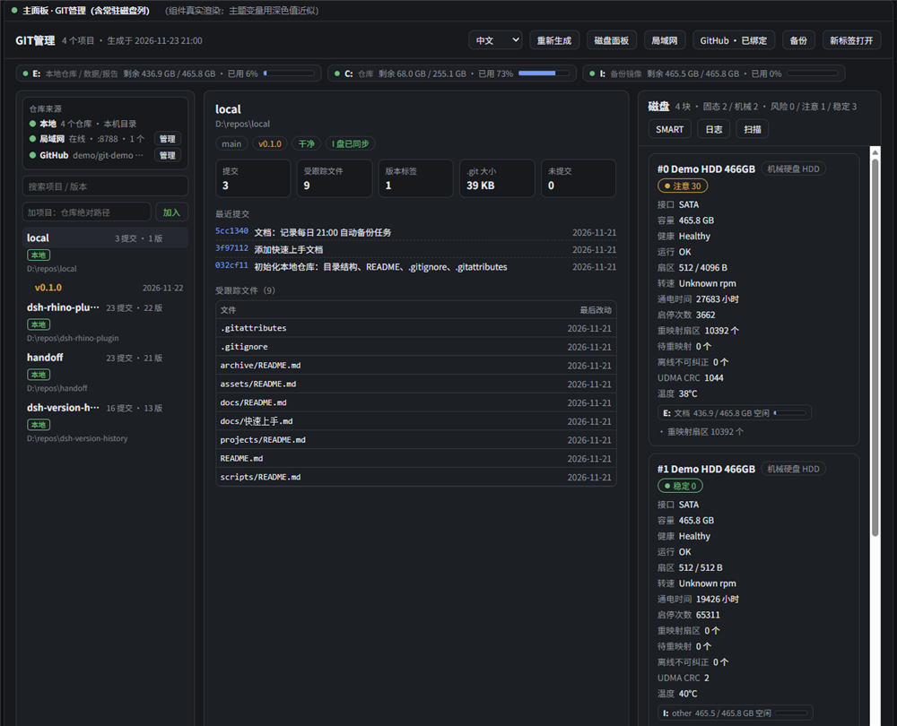
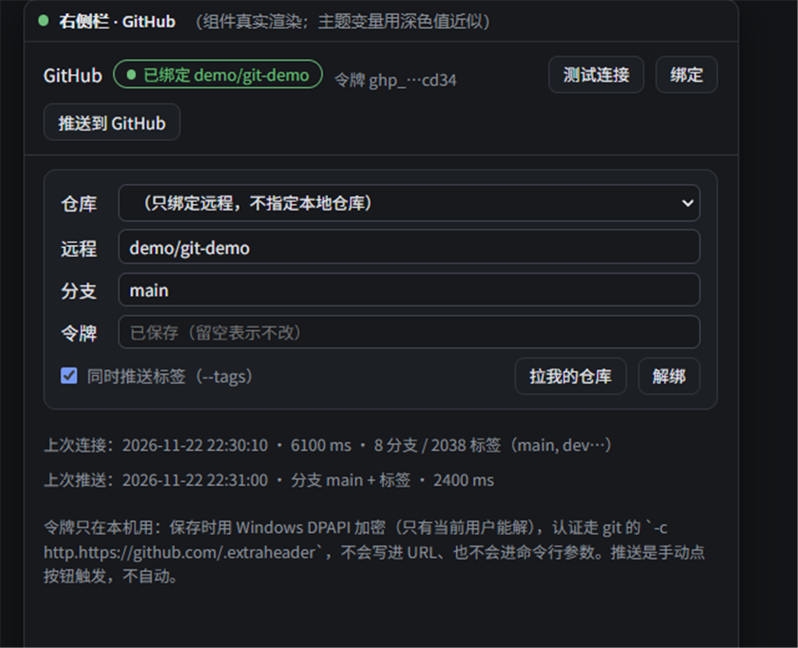
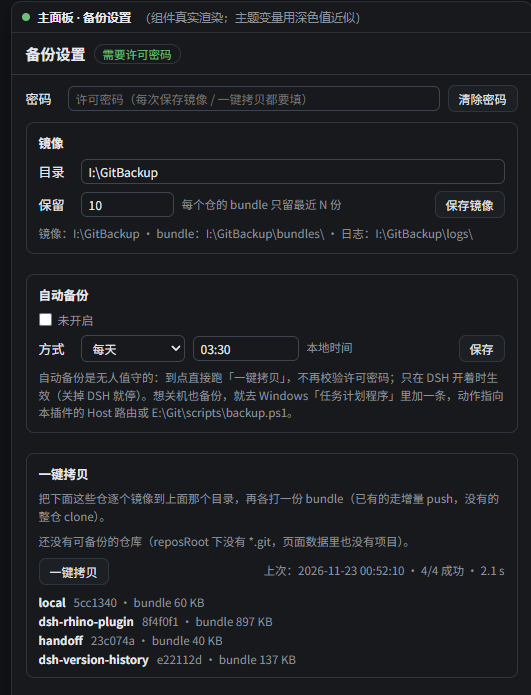

# dsh-version-history（GIT管理）

DeepSeek Harness（DSH）侧边栏插件：把本机 git 仓的**版本变化**、**磁盘健康 / SMART**、**局域网共享**、**GitHub 推送**收在一个面板里。







- 侧边栏入口 `GIT管理`（`sidebar.panellist` id `version-history`，order 21）；主面板三栏 —— 左「仓库 / 版本」、中「提交明细」、右「磁盘」。
- 顶栏按钮：`重新生成` / `磁盘面板` / `局域网` / `GitHub` / `备份` / `新标签打开` —— 其中「磁盘面板 / 局域网 / GitHub」会**先在面板内切子视图**（带「← 返回」），同时尽量把右侧栏那一页也打开。
- **备份**：面板内「备份设置」区块 —— 设镜像目录 + 一键拷贝（镜像并打 bundle），可加一道许可密码（scrypt 哈希，首次打开问一次，也可以选择不设）。
- **GitHub 状态自动标记**：左栏每个仓库行名下面一行是徽章 —— `本地`/`局域网` + `GitHub 已同步` / `GitHub 领先 N` / `GitHub 落后 N` / `GitHub 未推送` / `GitHub 分叉`。自动探测：`origin` 是不是 github.com、远端同名分支 sha 与本地 HEAD 的关系（Host 侧算，3 分钟缓存，没联网就静默不显示）。
- 纯前端 fetch 本包 Host half 的同源路由取数，不拉 iframe（能吃到 DSH 的主题变量与 locale）。

## 安装

### 方式 A：从 Release 的 tarball 安装（推荐，不需要 clone）

每个版本都挂了 `dsh-version-history-<版本>.tgz` 附件，是 **npm 布局**（包根在 `package/`），所以既能给 DSH 装，也能给 npm/pnpm 装。

```powershell
$ver = '0.1.10'   # 换成你要的版本
$url = "https://github.com/Tanjintao2/dsh-version-history/releases/download/v$ver/dsh-version-history-$ver.tgz"
$tmp = Join-Path $env:TEMP "dsh-vh-$ver"

New-Item -ItemType Directory -Force $tmp | Out-Null
Invoke-WebRequest $url -OutFile (Join-Path $tmp 'pkg.tgz')

# 解包 → 得到 <tmp>\package\（Windows 10/11 自带 tar）
tar -xzf (Join-Path $tmp 'pkg.tgz') -C $tmp
```

然后交给 DSH 装（`plugin_manager` 收目录，不认 .tgz 本身）：

```
plugin_manager: action=install_bundle, target=<tmp>\package
plugin_manager: action=set_plugin,   target="include:dsh-version-history", enabled=false
plugin_manager: action=set_plugin,   target="include:dsh-version-history", enabled=true
```

- `install_bundle` 会把包复制进 `<DSH_HOME>\profiles\<profile>\node_modules\dsh-version-history\`，并在该 profile 的补丁层写一行。
- `set_plugin false → true` 只是让 **host half** 重新 import；**client half 改动要刷新 DSH 窗口**（或重启）才换 JS。
- 装完侧边栏应出现 `GIT管理`；自检：`GET http://127.0.0.1:<DSH 端口>/version-history/health` 返回 `{"ok":true, ...}`，里面列的就是**这次真正生效的路径**（对不上说明 profile 补丁层有覆盖）。

**怎么确认装的是哪个版本**：看已装目录 `node_modules\dsh-version-history\package.json` 的 `"version"`（`/version-history/health` 不回版本号，只回路径）。

> 想钉旧版本就把 `$ver` 改成 `0.1.4` 之类；Release 附件长期保留。
> 有 npm 的环境也可以直接 `npm i <下载下来的 .tgz>`（只是装进普通 node_modules，不会自动注册到 DSH）。

### 方式 B：从源码目录安装（开发/改名改代码时用）

```powershell
# 装（给本目录绝对路径）
#   plugin_manager: action=install_bundle, target=<本目录>
# 改完 host half 重载
#   plugin_manager: action=set_plugin, target="include:dsh-version-history", enabled=false → true
# 改完 client half：DSH 窗口刷新页面
```

### 装完要配的（可选）

插件默认从 `~/.dsh-version-history` 派生所有路径，**开箱即用**；若你的脚本/报告在别处（例如 `E:\Git\scripts`、`E:\Git\reports`），按下面「配置（可移植）」那节在自己的 profile 补丁层覆盖，不要改包内文件。

## 备份（镜像 / 一键拷贝 / 许可密码）

主面板顶栏「备份」→「备份设置」：

1. **镜像**：填镜像根目录（绝对路径，例如 `I:\GitBackup`）→「保存镜像」。目录不存在会建；界面回显派生的 `bundles/`、`logs/`。
2. **一键拷贝**：把下面列出的仓逐个镜像过去（已有的 `git push --mirror`，没有的 `git clone --mirror`），再各打一份
   `bundles/<名字>-<yyyymmdd-HHmmss>.bundle`；每个仓只保留最近 `保留 N 份`（默认 10）。
   要备份的仓 = `reposRoot` 下的裸仓 + `data.json` 里列出的项目仓（按名字去重）。
3. **许可密码**：第一次打开会问「要不要设密码」——
   - 设了：以后每次「保存镜像」「一键拷贝」都要输入，否则 Host 侧直接拒绝（`needPassword` / `badPassword`）；
   - 不设：写 `passwordMode:'none'`，之后不再询问；也可以随时在这个区块里补设或清除。
   密码用 `scrypt` 加盐哈希存在 `reports/backup.json`，**不存明文、不回显**。
4. **自动备份**：这块是 0.1.6 新增的「自动备份」卡——
   - 勾上开关 = 到点自动跑一次「一键拷贝」；节奏选 `每天 HH:mm` 或 `每隔 N 分钟`（5–1440）。
   - **无人值守**：`auto` 触发时**不校验许可密码**（手动点「一键拷贝」仍然要输）。
   - 由 Host 侧定时器驱动（每 60 秒看一眼到点没，启动后 15 秒补看一次），
     **只在 DSH 开着时生效**；要 7×24 请在 Windows「任务计划程序」里另加一条。
   - 上次自动运行时间与成功/失败会显示在这张卡上（`backup.json` 的 `auto.lastRunAt` / `auto.lastOk`）。

> 每天 21:00 的计划任务（外部 `backup.ps1`）仍然独立运行；面板里这个按钮是**手动补一次**，覆盖全部项目仓。

### 每天 21:00 的那个 Windows 计划任务（也覆盖全部仓库）

`GitBackup-Local`（任务计划程序，每天 21:00）现在跑的是 **`E:\Git\scripts\backup-all.ps1`**：
读 `E:\Git\reports\repos.json` 加上 `E:\Git\repos\*.git` 去重，逐仓 `push --mirror`（没有就 `clone --mirror`）
+ `bundle create --all`，bundle 按名字轮转保留最近 `-Keep`（默认 10）份，日志 `I:\GitBackup\logs\backup-all.log`，
最后跑一次 `visualize.ps1 -NoOpen` 刷新页面（面板与离线页读同一份 `data.json`）。

```powershell
# 手动跑一次（不开页面）
powershell -NoProfile -ExecutionPolicy Bypass -File E:\Git\scripts\backup-all.ps1
# 只看会做什么
powershell -NoProfile -ExecutionPolicy Bypass -File E:\Git\scripts\backup-all.ps1 -DryRun
```

> 面板里的「自动备份」是**DSH 进程内**的定时器（只在 DSH 开着时生效）；21:00 这条是系统级任务，关机不跑但开机后按计划继续，两者互不冲突。

## 配置（可移植）

**代码里没有任何个人绝对路径。** 目录默认从 `~/.dsh-version-history` 派生：

```
~/.dsh-version-history/
├── reports/     data.json、health.json、smart.json、repos.json、github.json、backup.json、history.html
└── scripts/     visualize.ps1、disk-health.ps1、disk-health-admin.ps1、smart-launch.ps1、dpapi.ps1
```

优先级：**插件 config > 环境变量 > 上面的默认值**。

| 环境变量 | 作用 |
|---|---|
| `DSH_VH_ROOT` | 根目录（自动派生 reports / scripts / repos） |
| `DSH_VH_REPORTS` | 只改 reports 目录 |
| `DSH_VH_SCRIPTS` | 只改脚本目录 |
| `DSH_VH_REPOS_ROOT` | 局域网服务对外提供的裸仓目录（默认 `<root>/repos`） |
| `DSH_VH_GIT` | git 可执行文件（默认 `git`，走 PATH） |
| `DSH_VH_LAN_PORT` | 局域网 Smart HTTP 端口（默认 8788） |
| `DSH_VH_REPOS` | 预置仓库清单（分号或逗号分隔的绝对路径），只在 `repos.json` 还不存在时生效 |

需要指到别处（例如本机把脚本放 `E:\Git\scripts`、报告放 `E:\Git\reports`），在**自己的 profile 补丁层**覆盖 config，不要改本包：

```yaml
- id: dsh-version-history
  name: dsh-version-history
  config:
    dataPath: 'E:\Git\reports\data.json'
    reportPath: 'E:\Git\reports\版本历史.html'
    scriptPath: 'E:\Git\scripts\visualize.ps1'
    reposPath: 'E:\Git\reports\repos.json'
    healthPath: 'E:\Git\reports\health.json'
    healthScript: 'E:\Git\scripts\disk-health.ps1'
    smartPath: 'E:\Git\reports\smart.json'
    smartScript: 'E:\Git\scripts\disk-health-admin.ps1'
    smartLauncher: 'E:\Git\scripts\smart-launch.ps1'
    smartStatePath: 'E:\Git\reports\smart.state.json'
    smartLogPath: 'E:\Git\reports\smart.log'
    githubPath: 'E:\Git\reports\github.json'
    dpapiScript: 'E:\Git\scripts\dpapi.ps1'
    reposRoot: 'E:\Git\repos'
    gitExe: 'E:\Git\tools\git\cmd\git.exe'
    lanPort: 8788
```

## 依赖的外部脚本（本包不含）

本包只编排，不生成数据。脚本由你自备，契约如下：

| 脚本 | 调用方式 | 契约 |
|---|---|---|
| `visualize.ps1` | `-NoOpen`（刷新按钮） | 生成 `data.json`；`repos.json` 是它读的仓清单 |
| `disk-health.ps1` | `-Out <healthPath>` | 写盘健康 JSON；**必须显式给 `-Out`**，否则只打 stdout |
| `disk-health-admin.ps1` | `-Out <smartPath> -Log <smartLogPath>` | 采集 SMART；有管理员权限才拿得到 NVMe 寿命等存储栈计数器，否则降级标 `elevated=false` |
| `smart-launch.ps1` | 无参 | `Start-Process -Verb RunAs -Wait` 拉起上面的 admin 脚本，把 `phase` / `exitCode` / `error` 写进 `smart.state.json`（UAC 取消也落原因） |
| `dpapi.ps1` | `-Mode Protect`（明文走 stdin）<br>`-Mode Unprotect -B64 <ciphertext>` | 用 Windows DPAPI(CurrentUser) 加解密；GitHub 令牌只以密文落盘 |

## 路由（Host half，前缀 `/version-history`）

`health`、`data.json`、`report`、`refresh`、`repos`、`repos/add`、`repos/remove`、`disks.json`、`disks/scan`、`smart.json`、`smart.state.json`、`smart.log`、`smart/scan`、`lan.json`、`lan/start`、`lan/stop`、`lan/firewall`、`github.json`、`github/test`。

写操作走 `POST /dsh-vh/gh`（body `action` ∈ `bind | unbind | test | push | repos`）—— DSH 的 `webServer.resource` 路由只放行 GET，POST 必须在宿主层被 405 之前另开一条普通 handler。

## 目录

```
lib/index.js      Host half（路由、磁盘/局域网/GitHub 编排）
lib/paths.js      可移植默认路径（环境变量 → PATH_DEFAULTS）
lib/client.js     Client half（slots 注册 + 三栏面板 + 子视图）
lib/lan.js        局域网 Smart HTTP（git-upload-pack / git-receive-pack）
lib/github.js     GitHub 绑定 / 测试 / 推送 / 列仓
locale/*.json     插件元数据（meta.title = GIT管理）
docs/DETAIL.md    设计细节、数据流
docs/screenshots/ README 用截图
cordis.patch.yml  插件行（config 留空，用默认值）
```

## 自测与预览

```powershell
$node = '<dsh 运行时>/node/bin/node.exe'
& $node selftest.mjs          # slot 注册
& $node selftest-panel.mjs    # 面板 / 磁盘 / 局域网 / GitHub 渲染断言
& $node selftest-lan.mjs      # 局域网 Smart HTTP 端到端（clone/push，临时仓）
& $node render-preview.mjs    # preview-main.html / preview-disks.html / preview-lan.html
& $node render-preview.mjs --github
```

## License

[MIT](LICENSE) © 2026 Tanjintao2
